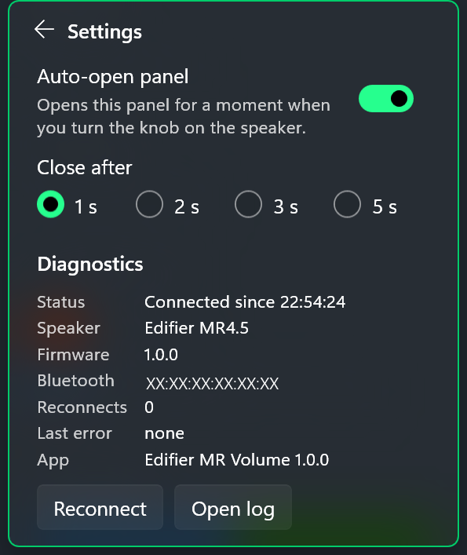

# Edifier MR Volume

> [!IMPORTANT]
> This is an independent project. It is made for Edifier speakers, but it is not affiliated
> with, endorsed by or supported by Edifier.

A Windows app for Edifier MR studio monitors (MR4.5, MR3, MR5). It shows the speakers' own
volume as a number in the taskbar, and lets you change the volume, sound mode, equalizer, room
tuning and power saving.

It talks to the speakers over Bluetooth LE, like Edifier's ConneX phone app, so it works with
any audio input and doesn't touch the Windows volume.


## Supported speakers

| Model | Status |
| --- | --- |
| MR4.5 | Tested |
| MR3 | Should work: same protocol, verified on an MR3 by other projects (see Credits). Not tested with this app. |
| MR5 | Should work: same volume messages in MR5 captures. Not tested with this app. |
| MR4.5 / MR5 with the 8625 DSP | Should work, not tested |

Reports for the untested models are welcome.

## Features

- **The number in the taskbar** is the volume (0-30). Scroll over it to change it.
- **Click it** for the panel: sound mode, volume, mute and power off. The light next to the
  modes has the speaker's colour (red Monitor, green Music, white Custom); click it for the
  next mode.
- **Right-click it** for the menu: Open, Turn off speakers, Connect to speaker, Start with
  Windows, Exit.
- **Keyboard:** Win+B, arrow keys to the number, then Enter for the panel or Shift+F10 for the
  menu. In the panel the arrow keys change the volume and Esc closes it.
- **Reconnects by itself** after the speakers are switched off and on, and after sleep.

Settings, behind the gear:

| Setting | What it does |
| --- | --- |
| Auto-open panel | Shows the panel for a moment when you turn the knob. Off by default. |
| Volume limit | The app never sets the volume higher (24 by default). The knob isn't limited. |
| Start volume | Sets a volume when the app connects. Off by default. |
| Equalizer | Deep bass, Balanced, Deep + balanced, or Your curve (9 bands). Switches to Custom mode. |
| Room | Where the speakers stand, how much bass, and whether they're on a desk. |
| Turn off when the PC sleeps | Off by default. |
| Power saving | The speakers' own standby after 15 minutes without sound. |
| Diagnostics | Connection details, Reconnect and Open log. |



## Install

Windows 10 2004 or later, on x64 or Arm. No Bluetooth pairing needed.

- **Installer:** download `edifier-mr-volume-vX.Y.Z-win-x64-setup.exe` (or `-win-arm64-setup.exe`) from
  [Releases](https://github.com/tomcoolpxl/edifier-mr-volume/releases) and run it. No admin
  rights needed. Uninstall it from Windows' Installed apps.
- **Portable:** download `edifier-mr-volume-vX.Y.Z-win-x64.zip` (or `-win-arm64.zip`), unpack it anywhere and run
  `EdifierMrVolume.exe`. Nothing else to install.
- **Scoop:**

  ```powershell
  scoop bucket add tomcoolpxl https://github.com/tomcoolpxl/scoop-bucket
  scoop install edifier-mr-volume
  ```

Settings and the log are in `%LOCALAPPDATA%\EdifierMrVolume`. To remove a portable copy, turn
off Start with Windows, choose Exit, and delete its folder and that one.

`EdifierMrVolume.exe --show` opens the panel; `--exit` closes the running app.

## Problems

**No number in the taskbar?** Windows hides new icons. Turn it on under Settings >
Personalization > Taskbar > Other system tray icons (Windows 10: Select which icons appear on
the taskbar). The app shows this hint on its first start.

**The phone app can't connect?** The speakers accept one control connection at a time. Turn
off **Connect to speaker** while you use ConneX.

## Why Native AOT

The app runs all day, so it should start fast and stay small. It is compiled ahead of time
with Microsoft's [Native AOT](https://learn.microsoft.com/dotnet/core/deploying/native-aot/),
so no .NET runtime ships with it. Measured against a normal .NET build on the same PC:

| | Normal .NET | Native AOT |
| --- | ---: | ---: |
| Start, until the number shows | 0.40 s | 0.19 s |
| CPU in one idle minute | 109 ms | 31 ms |
| Memory (working set) | 117 MB | 76 MB |
| Install size | 237 MB | 173 MB |

A partial C++ version was only a little smaller. Details:
[docs/NATIVE-AOT.md](docs/NATIVE-AOT.md).

## Develop

Needs the .NET 11 SDK and Visual Studio's "Desktop development with C++" workload, which
Native AOT uses to link. The app targets .NET 10 and the Windows 11 SDK (10.0.26100), with
WinUI 3 (Windows App SDK 2.6) and [H.NotifyIcon](https://github.com/HavenDV/H.NotifyIcon).

```powershell
dotnet test tests/EdifierMrVolume.Core.Tests                  # protocol tests
dotnet build src/EdifierMrVolume/EdifierMrVolume.csproj -p:Platform=x64
.\tools\install.ps1                                           # publish, install and start
```

Only one copy runs at a time, so exit the installed one before starting another.

Commit messages follow Conventional Commits, because the release notes are built from them.
CI builds, tests and installs the app on every push, on x64 and on Windows on Arm. A release
is Actions > Release > Run workflow; see [docs/RELEASING.md](docs/RELEASING.md).

| Path | What |
| --- | --- |
| `src/EdifierMrVolume.Core` | Protocol and Bluetooth connection |
| `src/EdifierMrVolume` | The WinUI 3 app |
| `tests/EdifierMrVolume.Core.Tests` | Protocol tests with bytes from real speakers |
| `tools/install.ps1` | Publish and install for the current user |
| `tools/package.ps1` | Release files: zips, installers, checksums |
| `packaging/inno` | Installer script (Inno Setup) |
| `assets/icon` | App icon sources |
| `tools/probe.py` | Bluetooth probe used to work out the protocol |
| `tools/eq_audition.py` | Plays an EQ preset on the speaker to hear it |
| `.github/workflows` | CI, releases, and merging Dependabot updates |
| `docs` | Releasing, Native AOT measurements, UX review |

## Protocol

Verified on an MR4.5 (firmware 1.0.0) in November 2026.

| Item | Value |
| --- | --- |
| Advertised name | `EDIFIER BLE`, manufacturer id `0x07E0` |
| Advertised search UUID | `00006303-0000-1000-8000-00805f9b34fb` |
| Control service | `48096303-1a48-11e9-ab14-d663bd873d93` (MR3: `4809f301-...`, MR5: `48093a01-...`) |
| Notify characteristic | `48090001-1a48-11e9-ab14-d663bd873d93` |
| Write characteristic | `48090002-1a48-11e9-ab14-d663bd873d93` |

Packets: `AA <appCode> <cmd> <lenHi> <lenLo> <payload...> <checksum>`, where the checksum is the
sum of the bytes before it, & 0xFF. Replies start with `BB EC`. The 8625 DSP revisions
reportedly use `...7c03...` instead of `...6303...`; the app tries both.

| Command | Request | Reply on the MR4.5 | Used |
| --- | --- | --- | --- |
| `0x66` get volume | `AA 0C 66 00 00 1C` | `BB EC 66 00 02 1E 13 40`: max 30, now 19. Also sent on every knob step. | yes, every 5 s |
| `0x67` set volume | `AA 0C 67 00 01 <level> <sum>` | ack, then a `0x66` reply | yes |
| `0xC6` firmware | `AA 0C C6 00 00 7C` | `01 00 00` = 1.0.0 | Diagnostics |
| `0xC9` model name | `AA 0C C9 00 00 7F` | `EDIFIER MR4.5` | Diagnostics |
| `0xD5` sound mode and room tuning | `AA 0C D5 00 00 8B` | `00 02 00 1E 03 00 01`: mode 0 (Monitor), then six room-tuning bytes. Also sent when the speaker's button changes the mode. | yes, every 5 s |
| `0xC4` set sound mode | the 7 bytes from `0xD5` with the mode replaced, e.g. `AA 0C C4 00 07 01 02 00 1E 03 00 01 A6` (Music) | ack, then a `0xD5` | yes |
| `0x43` custom EQ | `AA 0C 43 00 00 F9` | 9 bands of `[index][freqHi][freqLo][gain]`, 62 Hz to 16 kHz, gain 0-12 (6 = flat) | yes |
| `0x44` set an EQ band | `[slot][index][freqHi][freqLo][gain]`, e.g. `AA 0C 44 00 05 01 00 00 3E 0B 49` | ack | yes |
| `0xB1` power saving | `AA 0C B1 00 00 67` | `00` off, `01` on | yes |
| `0xB2` set power saving | `AA 0C B2 00 01 00 69` (off), `... 01 6A` (on) | the previous value | yes |
| `0xCE` power off | `AA 0C CE 00 00 84` | none; the speakers switch off | yes |
| `0xD1`/`0xD2`/`0xD3` shutdown timer | `AA 0C D3 00 00 89` | `00 00` = off | no |
| `0x61` input | `AA 0C 61 00 00 17` | `04 01`, meaning unknown | no |
| `0xD8` features | `AA 0C D8 00 00 8E` | 29 bytes, not decoded | no |
| `0xD7`, `0xF2`, `0xF7` | | no reply on the MR4.5 | no |

Room tuning, the six bytes after the mode (layout from
[omarchy-edifier-mr5](https://github.com/Devis99/omarchy-edifier-mr5), meanings from the MR4.5
manual):

| Byte | Meaning | Values |
| --- | --- | --- |
| index | calibration index | unknown, kept as read |
| byte0 | 1 resets the DSP calibration | kept as read |
| low cut | high-pass frequency | 20-100 Hz in 5 Hz steps |
| slope | low-cut steepness | 0-3 = 6, 12, 18, 24 dB per octave |
| acoustic space | bass cut for walls nearby | 0-4 = 0 to -4 dB |
| desktop | cuts the boost from a desk | 0 off, 1 on |

The app only changes the low cut, slope, acoustic space and desktop bytes, within these ranges,
and keeps the rest as the speaker reported them. The size of one EQ step in dB isn't published,
so the app shows steps.

### Probe script

Exit the app (or turn off Connect to speaker) first: only one client can connect.

```powershell
python -m venv .venv
.venv\Scripts\python.exe -m pip install bleak
.venv\Scripts\python.exe tools\probe.py                       # find the speaker, read the volume
.venv\Scripts\python.exe tools\probe.py --watch 30            # print knob changes for 30 s
.venv\Scripts\python.exe tools\probe.py --read D5 --read 43   # send queries, print the replies
.venv\Scripts\python.exe tools\probe.py --set-test            # one step down and back (writes)
.venv\Scripts\python.exe tools\probe.py --power-off           # switch the speakers off (writes)
```

## Credits

The protocol comes from these MIT-licensed projects:

- [D4n13l3k00/EdifierControl](https://github.com/D4n13l3k00/EdifierControl): MR4.5 and MR3 IDs, the volume reply, commands, EQ layouts, room-tuning values
- [Saikomantisu/omarchy-edifier-mr3](https://github.com/Saikomantisu/omarchy-edifier-mr3): MR3 service, sound mode and EQ
- [Devis99/omarchy-edifier-mr5](https://github.com/Devis99/omarchy-edifier-mr5): packet format, commands, room-tuning layout
- [68776877/Edifier-IR-remote](https://github.com/68776877/Edifier-IR-remote): MR5 captures
- [wh201906/mEDIFIER](https://github.com/wh201906/mEDIFIER): the shutdown-timer commands

The power-saving commands were found with this project's probe. The release process follows
[cash](https://github.com/tomcoolpxl/cash).

## License

[MIT](LICENSE)
